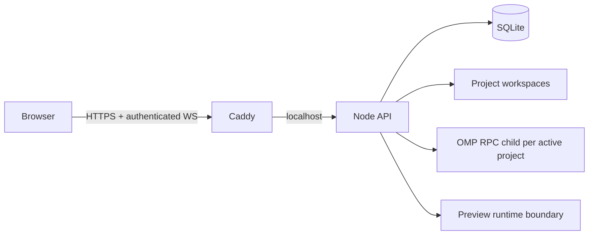

# Architecture

## Boundary

OMP Builder is a new web application. Open-Laudable is a read-only design reference, not a base repository. No Electron package, IPC channel, desktop filesystem implementation, or original AI orchestration is included.

## Runtime topology

- Frontend: React + TypeScript + Vite + Tailwind CSS. Monaco is reserved for the Phase 3 editor package.
- Backend: Node.js LTS + TypeScript. Node is selected for the MVP because it is the standard production runtime for the React/Vite stack and supports mature HTTP/WebSocket/SQLite packages. The inspected VPS currently has neither Node nor Bun installed, so deployment must install Node 22 LTS explicitly.
- Persistence: SQLite with migrations. Phase 1 stores administrator, session, and project metadata. Project files remain out of the database.
- Transport: same-origin HTTP API and authenticated WebSocket upgrade. The browser never receives a raw OMP stdio stream.
- Process model: the backend will own one OMP `--mode rpc` process per active project session. OMP's documented custom JSONL protocol and `RpcClient` semantics are the integration contract. `rpc-ui` is not selected for Phase 1 because no extension approval UI exists yet; Phase 2 will implement a fail-closed approval bridge before enabling UI requests.

## Security invariants

1. All project paths are derived from server-owned project IDs and resolved beneath `PROJECTS_ROOT`.
2. Session cookies are HTTP-only, SameSite=Lax, and secure in production.
3. Credentials are backend-only and encrypted before persistence in Phase 2.
4. OMP children receive a project cwd and restrictive approval configuration; no public process endpoint exists.
5. Preview execution is a separate container boundary in Phase 3. The host Docker socket is never mounted.
6. WebSocket authorization is checked during upgrade and again against the session/project relationship.

## Data model direction

- `admins`: single administrator identity and password hash.
- `sessions`: random opaque token hash, expiry, revocation timestamp, audit timestamps.
- `projects`: stable ID, name, prompt summary, workspace path, OMP session metadata, timestamps.
- `providers`: encrypted API key and OMP `models.yml` projection (Phase 2).
- `messages`, `events`, `audit_log`: append-oriented persistence (Phase 2+).

## VPS audit

The inspected host exposes SSH (22), systemd-resolved DNS, and Performance Co-Pilot ports 4330/44321–44323. No Node.js, npm, Bun, Caddy, Docker, or application listener was available in PATH/listener output. This project does not change those services or firewall rules.
